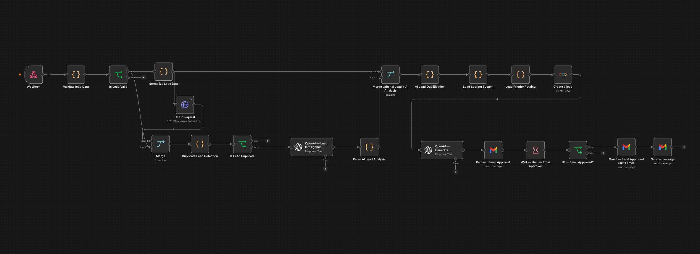
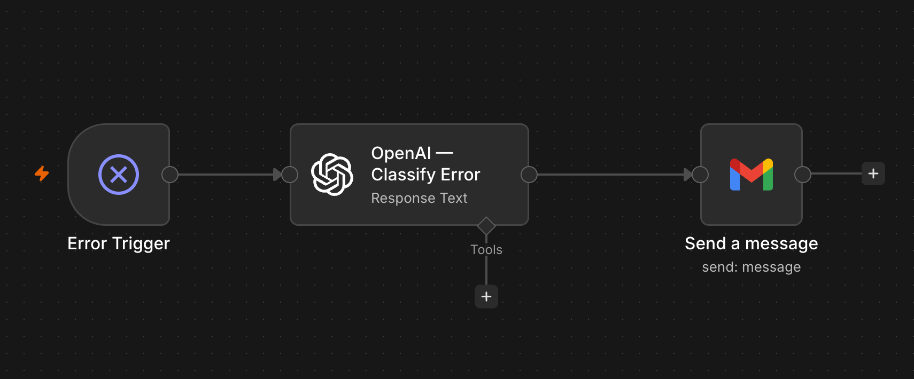

# LeadFlow AI 2.0 — Intelligent Lead Qualification & CRM Automation

## Overview
LeadFlow AI is an AI-powered sales automation workflow built with n8n.
It automates lead validation, duplicate detection, AI-powered lead analysis,
lead scoring, CRM integration, and sales approval.

## Key Features
- Lead data validation
- Duplicate lead detection
- AI-powered lead analysis using OpenAI
- Automated lead scoring and prioritization
- Zoho CRM integration
- Gmail notifications
- AI-generated personalized sales emails
- Human approval before sending sales emails
- Error classification and email alerts through a supporting workflow

## Technology Stack
- n8n — Workflow automation
- OpenAI — AI-powered lead analysis
- Zoho CRM — Lead management
- Gmail — Notifications and approval emails
- Webhooks — Workflow triggering and approval callbacks

## Workflow
1. Receive lead information through a webhook.
2. Validate and normalize the submitted data.
3. Check for duplicate leads.
4. Analyze the lead using AI.
5. Calculate a lead score and priority.
6. Create the lead in Zoho CRM.
7. Generate a personalized sales email.
8. Request human approval before sending the email.
9. Send an error alert when a workflow failure occurs.

## Workflow

1. Receive lead information through a webhook.
2. Validate and normalize the submitted data.
3. Check for duplicate leads.
4. Analyze the lead using AI.
5. Calculate a lead score and priority.
6. Create the lead in Zoho CRM.
7. Generate a personalized sales email.
8. Request human approval before sending the email.
9. Send an error alert when a workflow failure occurs.

## Workflow Screenshots

### Main Lead Qualification Workflow

### Error Handling Workflow

## Architecture
LeadFlow AI follows a modular automation workflow:

1. **Webhook Intake** — Receives incoming lead data.
2. **Data Validation** — Checks required fields and normalizes input.
3. **Duplicate Detection** — Helps prevent duplicate lead creation.
4. **AI Lead Analysis** — Uses OpenAI to analyze lead information.
5. **Lead Scoring** — Calculates a score and priority for each lead.
6. **CRM Integration** — Creates lead records in Zoho CRM.
7. **Sales Approval** — Requests human approval before sending a sales email.
8. **Error Monitoring** — A supporting workflow classifies failures and sends email alerts.

## Project Status
Core workflow built and tested. Preparing for secure publication,
deployment, and portfolio documentation.

## Demo and Privacy
This repository documents the project's design and functionality.
Live credentials, private customer information, and production
webhook URLs must not be published.

A sanitized workflow export and demonstration materials can be added
after the export has been reviewed for sensitive configuration.

## Security
This repository must not contain API keys, passwords, access tokens,
private customer information, or other sensitive credentials.
